# Taiko Risshiden III — English Translation

A fan translation of **Taiko Risshiden III** (太閤立志伝III, Koei) for the PlayStation into
English. It is a life simulation set in Japan's Warring States period: you start in 1560 as
Kinoshita Tōkichirō, a foot soldier of the Oda clan, attend your lord's councils, compete with
the other retainers for missions, travel the country, train, trade, make friends, fight battles
and rise rank by rank towards the man history knows as Toyotomi Hideyoshi. A second story follows
Shibata Katsuie. The game was only released in Japan.

> **This is a full machine translation.** All of the game's text was translated from
> Japanese by an AI model, not by a human translator, and it has not been
> proofread by a fluent Japanese speaker. Expect occasional mistranslations, awkward
> phrasing and inconsistent terms. Corrections are welcome.

> **This is a beta.** All of the game's text is in English, but only the first months of the
> first story have been played: the opening, the first missions, several councils, a promotion,
> the buildings of Kiyosu, Iwamura and Sakai, and one siege (won and lost). Nearly all of the
> later story and the whole second story have not been seen on screen.
> Expect some text that is squeezed, cut short or wrapped oddly later on.

This repository contains the English text and the tools that build the patch.
It does **not** contain the game, any of its data, or the Japanese script — you need
your own copy of the game.

## Screenshots

| | | |
|:-:|:-:|:-:|
| 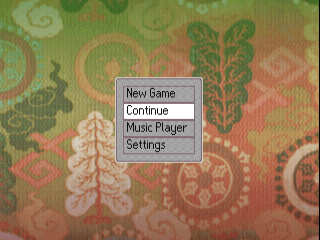 | 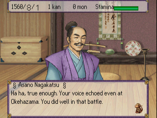 | 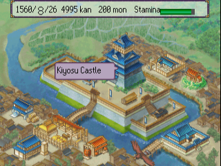 |
| Title menu | Opening scene | Kiyosu |
| 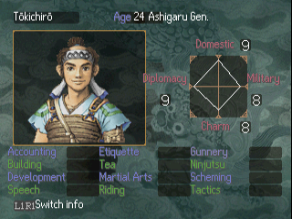 | 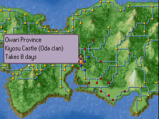 | 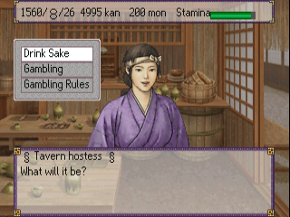 |
| Person detail | Travel map | Tavern |
| 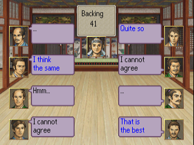 | 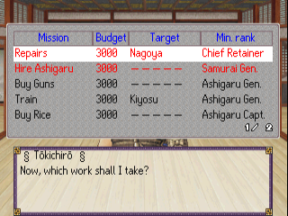 | 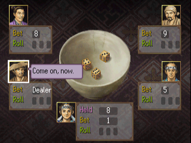 |
| Council vote | Mission list | Chinchirorin |
| 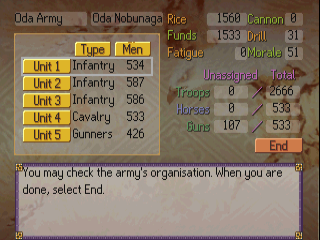 | 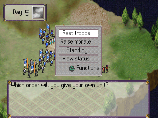 | 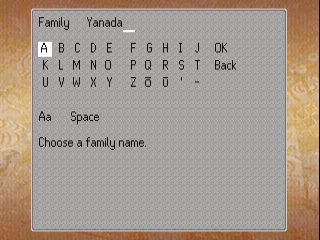 |
| Army organisation | Siege orders | Name entry |

## What's translated

- All 55 message blocks of the game script: councils, missions, every building of the towns,
  the story events of both stories, battles, item descriptions, help texts and the biographies
- All people's names, castles, provinces, clans, ranks, items and commands, with macrons
  (Tōkichirō, Ōmi, Daimyō), consistent with the English patches of Taiko Risshiden IV and V
- Menus, lists and information screens, with their columns re-spaced for English
- Battle screens and messages
- Save and memory card messages; saves keep the game's own layout
- Labels that are part of pictures: the person detail, battle organisation and unit screens,
  the Yes / No buttons, the gambling board
- An English name entry screen for the hero of the Special Tale
- A proportional English font (original drawings) with word wrap; long dialogue is split over
  several pages, and lines with names in them are wrapped while the game runs

Long labels are shortened where the game's boxes are too small.

## Applying the patch (players)

You need:

- **Your own copy of the Japanese disc as a disc image**: one `.bin` file (a `.cue` comes with
  the patch). The patch is made for the **"Koei the Best" / "Koei Teiban" reissue**
  (`SLPM-86608` / `SLPM-87275`; Redump calls it "Rev 1"). The 1999 original release
  (`SLPM-86268`) is a different image and is not supported yet. The patch does not contain the
  game.
- **A patching program.** [Delta Patcher](https://github.com/marco-calautti/DeltaPatcher) is
  free and needs no installation.
- **A PlayStation emulator.** The patch was tested in [DuckStation](https://www.duckstation.org/).

Steps:

1. **Download the patch.** Get `Taiko_Risshiden_3_English_v<version>.zip` from the
   [Releases page](https://github.com/damon-daemon/taiko-risshiden-3-english/releases)
   and unzip it. Inside are the patch (`.xdelta`), a `.cue` file and a README.txt.
2. **Copy the disc image.** Make a copy of your `.bin` file and give the copy exactly this
   name, with the version number of the zip you downloaded (for example `v0.9.0`):

   `Taiko Risshiden III (English v<version>).bin`

   Keep the original file as it is.
3. **Patch the copy.** Open Delta Patcher. Under **Original file** choose the copy you just
   made, under **XDelta patch** choose the `.xdelta` file from the zip, and click
   **Apply patch**.

   If it reports a checksum error, your disc image is not the one the patch was made for:
   compare it with the table below.
4. **Put two files in one folder:** the patched `.bin` and
   `Taiko Risshiden III (English v<version>).cue` from the zip.
5. **Play.** Open that `.cue` file in your emulator.

If the emulator says it cannot find a file, the name in step 2 does not match exactly.

### Is my disc image the right one?

The patch fits an unmodified image of the Japanese reissue disc. The `.bin` must match:

| `Taikou Risshiden III (Japan) (Rev 1).bin` | |
|---|---|
| Size  | 382,745,664 bytes |
| CRC32 | `02EF70CF` |
| MD5   | `9d98c6d3c1c510f583a2e968b2ebc393` |
| SHA-1 | `9c4ead8a3c2c466b657472ae211ba07da60ac220` |

### Command line

Instead of Delta Patcher (steps 2 and 3) you can use `xdelta3`:

```
xdelta3 -d -s "Taikou Risshiden III (Japan) (Rev 1).bin" taiko_risshiden_3_en_v<version>.xdelta "Taiko Risshiden III (English v<version>).bin"
```

## Building from source

Requirements: Python 3.10+ (standard library only), `xdelta3` (for the patch file).

```
cp "/path/to/Taikou Risshiden III (Japan) (Rev 1).bin" taiko_risshiden_3.bin
python3 tools/setup.py      # checks the disc, extracts its files to extract/
python3 tools/build.py      # writes build/taiko_risshiden_3_en.bin (+ .cue) and the .xdelta
```

`script/`, `extract/` and `build/` hold data from your disc and are never committed.
`python3 tools/package.py <version>` then writes the release zip to `release/`.
No disc data is ever packaged. `requirements.txt` lists the packages of the development
helpers in `tools/dev/` only.

## Repository layout

| Path | Contents |
|---|---|
| `tl/msgNN.txt` | English for the message blocks of `DATA/MESSAGE.DAT`, by block and string number |
| `tl/names_*.json` | The people's names, the generic speakers, the hero's default names |
| `tl/tables/` | Castles, provinces, clans, ranks, items, commands, buildings, column heads |
| `tl/progstr/` | English for strings in the game program and its overlays, by address |
| `tools/setup.py`, `tools/build.py` | Check the disc and extract; build the patched disc and the patch |
| `tools/tl.py`, `tools/text.py` | Translation format, checks, wrapping and page splitting |
| `tools/msgfile.py`, `tools/msgpack.py`, `tools/softwrap.py` | Message file; block compression; the rewritten message interpreter with word wrap at run time |
| `tools/iso.py` | Disc image |
| `tools/scenario.py`, `tools/names.py`, `tools/player.py`, `tools/tables.py`, `tools/rectab.py` | Scenario data; person names; the hero's saved name; table names; record tables |
| `tools/progstr.py`, `tools/strbuf.py`, `tools/layout.py`, `tools/window.py` | Program strings; wider string buffers; screen layouts; the message window |
| `tools/vwf.py`, `tools/pixfont.py`, `tools/asm.py` | Proportional font and menu widths; the font drawings; small MIPS assembler |
| `tools/gfx.py`, `tools/nameentry.py` | Labels redrawn inside the game's pictures; the English name entry screen |
| `tools/package.py` | Makes the release zip |
| `docs/screenshots/` | README screenshots |
| `tools/dev/`, `tools/emu/` | Development helpers (disassembly, DuckStation automation) |

## Known issues

- Names you enter yourself (the hero of the Special Tale, a castle you build) are limited to
  12 letters for a family name, 9 for a given name and 8 for a castle.
- Text that is part of the scenery is unchanged: the title logo, shop signs, hanging scrolls.
  The movies have no subtitles in the Japanese game either.
- Some names of commands and missions read stiffly inside sentences ("Is Train all right?").
- Counts are not always matched ("1 days").
- Most of the game has not been seen in play. Its text may overflow in places.

Tested in DuckStation only. Bug reports with a screenshot and where it happened are welcome.

## Credits

- Translation and hacking: [damon-daemon](https://github.com/damon-daemon)
- Taiko Risshiden III © Koei Tecmo. This is an unofficial fan project, not
  affiliated with or endorsed by Koei Tecmo. Please support the official releases.

## License

The tools, fonts, documentation and English translation text in this repository
are released under the [MIT License](LICENSE). This covers only original work in
this repository: the game itself and all of its content (code, Japanese text,
graphics, audio) are copyright Koei Tecmo and are not included or licensed here.
